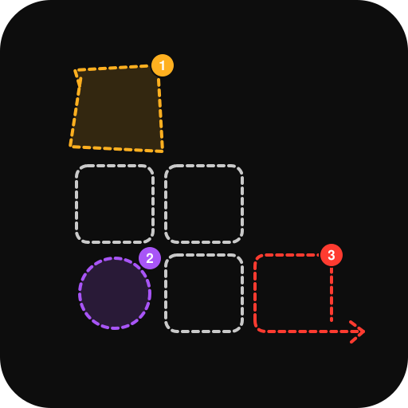

# Loomless

> Turn a working session into a readable story — not a video.

Loomless watches a session (clicking through a feature, debugging an issue, a
demo) and turns it into a structured, skimmable "story": ordered steps, each
with a screenshot and a caption, exported as Markdown so it can be dropped
straight into a PR, a ticket, or a repo's `/docs` folder. It's built to be
driven by a human recording themselves **or by an AI coding agent** (e.g.
Claude Code) narrating its own work through an MCP interface.

## Status

**Phase 1.5 (agent path) done. Human path on macOS: click-capture
(with a configurable highlight ring and optional auto-generated
captions), terminal capture, secret-masking, idle-timeout nudge, a
local editor (reorder/hide/caption/redact/highlight), and
Markdown/PDF/slides export all work. Linux: window/terminal capture
works (X11 only), automatic click-capture doesn't yet.** The agent path
(MCP server) works end to end on macOS. See
[`docs/product/00-README.md`](docs/product/00-README.md) for the full
product write-up, [`docs/product/10-open-questions.md`](docs/product/10-open-questions.md)
for what's still undecided, and [`docs/product/11-decisions.md`](docs/product/11-decisions.md)
for what's already resolved and why (capture engine: **Go**; accounts:
**optional/local-first**; editing model: **mutable with activity log**;
screenshots: **window-scoped, not full-screen**; terminal capture: **explicit
`loomless run` wrapper, not a full shell hook**; secrets: **pattern-masked at
capture time**; Linux: **X11 via standard tools, no click-capture yet**;
forgotten recordings: **desktop notification after 20min idle, not
auto-stop**; PDF/slides: **rendered directly from session data, pure Go,
no headless-browser/CDN dependency**; local editor: **web UI, not
TUI**; highlights: **numbered, editable annotations shared by the
automatic click-ring and manual highlights, not baked into pixels —
see decisions #14/#16/#18**; auto-captions: **local template by
default, macOS Accessibility API grounding, optional LLM rewrite via
Anthropic/OpenAI/Gemini/a local Ollama server — only when
`LOOMLESS_LLM_PROVIDER` names one explicitly, see decisions #33/#34**).
Not done: Windows, Wayland, sharing — all later phases.

## Platform support

| Platform | Status | Notes |
|---|---|---|
| **macOS** | ✅ Fully supported | The primary development platform — every feature (click capture, terminal capture, local editor, TUI, MCP server, auto-captions) is built and continuously exercised here. This is where bugs get caught first. |
| **Linux (X11)** | ⚠️ Partial, less-tested | Window/terminal capture and export are implemented and were verified against a real X11 session (a container running Xvfb + fluxbox + `xdotool`/`wmctrl`/`xprop`/`maim`, not just cross-compiled — see decision #10), which caught and fixed two real bugs. Automatic click-capture isn't implemented (X11 needs the XTest/RECORD extension or privileged input access — see decision #10). The local editor and TUI have no platform-specific code but haven't been independently verified running on Linux the way capture has, so treat them as "should work," not "confirmed." **Wayland isn't supported at all** — every dependency here is an X11-protocol tool. |
| **Windows** | ❌ Not supported | Currently **doesn't even build** on Windows (`internal/engine` uses a Unix-only field of `syscall.SysProcAttr` for detaching the click-daemon process) — nothing to do with the missing capture backend, which also doesn't exist yet. Not on the near-term roadmap; contributions welcome. |

If you hit something that looks platform-specific, it's disproportionately likely to be a Linux or (theoretical, since it can't build yet) Windows issue rather than a macOS one — please file it with your OS and desktop environment.

## Why

Explaining "what I did" today means choosing between a video (fast to
record, painful to consume, not diffable) or a manual write-up (skimmable,
but tedious enough that most people skip it). Loomless aims to be fast to
produce *and* fast to read — and to be usable by an AI agent narrating its
own reasoning, not just a human clicking through after the fact.

See [`docs/product/01-vision-and-goals.md`](docs/product/01-vision-and-goals.md)
for the full problem statement.

## Documentation

All product thinking lives in [`docs/product/`](docs/product/), read in this
order:

1. [Vision & goals](docs/product/01-vision-and-goals.md)
2. [Users & personas](docs/product/02-users-and-personas.md)
3. [Features (MVP / Phase 2 / Phase 3+)](docs/product/03-features.md)
4. [Usage scenarios](docs/product/04-usage-scenarios.md)
5. [Collaboration & sharing](docs/product/05-collaboration-and-sharing.md)
6. [Editing & versioning](docs/product/06-editing-and-versioning.md)
7. [Edge cases](docs/product/07-edge-cases.md)
8. [Technical considerations](docs/product/08-technical-considerations.md)
9. [Roadmap](docs/product/09-roadmap.md)
10. [**Open questions**](docs/product/10-open-questions.md) — the decisions
    that gate everything else

## Try it

The core loop: on macOS, `record start` watches your clicks automatically
(a listen-only event tap — it observes, never intercepts) and captures a
window-scoped, click-highlighted screenshot per click (not full-screen —
see [`docs/product/11-decisions.md`](docs/product/11-decisions.md) #5). Add
notes without a click via `loomless step`, or capture a command + its output
via `loomless run` — both work the same way on Linux (X11), just without the
automatic click part (decision #10) — use `loomless step`/`loomless run`
there instead.

```bash
go build -o loomless ./cmd/loomless
./loomless record start my-first-story        # add --highlight for a click ring, --auto-caption for generated captions
# macOS: click around normally — each click is captured automatically
./loomless step "optional note, no click needed"
./loomless run -- go test ./...     # captures the command + its output as a step
./loomless record stop
./loomless edit my-first-story                # reorder/hide/caption, redact (undo/redo), or add numbered highlight callouts
./loomless export my-first-story              # Markdown (default)
./loomless export my-first-story --format pdf    # or a PDF, screenshots embedded
./loomless export my-first-story --format slides # or a self-contained HTML slide deck
./loomless tui                                # or: browse all sessions, edit/export from a terminal dashboard
```

**Linux (X11) dependencies:** `xdotool`, `wmctrl`, `xprop` (usually
preinstalled), and [`maim`](https://github.com/naelstrof/maim) for
screenshots — e.g. `apt install xdotool wmctrl x11-utils maim`. Wayland
isn't supported (these are all X11-protocol tools).

**Forgot a recording was running?** After ~20 minutes of no activity
(`loomless step`/`loomless run`/clicks), you'll get a desktop notification
nudging you to stop it — it never auto-stops for you (see decision #11 in
[`docs/product/11-decisions.md`](docs/product/11-decisions.md)).

Notes, window titles, and `loomless run` commands/output are pattern-matched
for common secret shapes (API keys, tokens, `password=...`-style
assignments) and masked as `«masked»` before anything is written to disk —
see decision #7 in
[`docs/product/11-decisions.md`](docs/product/11-decisions.md). This is a
safety net, not a guarantee: it won't catch every shape, and it doesn't
hide anything from your *live* terminal — only from what gets saved.
Review before sharing a story publicly.

Output lands in `~/.loomless/sessions/my-first-story/`. First run prompts
for **Accessibility** (window info + click-capture) and **Screen
Recording** (screenshots) — both are optional (deny either and Loomless
still works, just with less auto-filled in) and one-time macOS prompts,
expected per [`docs/product/07-edge-cases.md`](docs/product/07-edge-cases.md).
See [`INSTALL.md`](INSTALL.md) for exactly why each permission is needed
and what happens if you skip it.

## Agent-driven capture (MCP)

`loomless mcp` runs an MCP server (stdio) exposing `start_recording`,
`capture_step`, `run_command`, `stop_recording`, `generate_story`, and
`list_windows` — so an agent like Claude Code can narrate its own work
instead of a human clicking through it (Scenario B in
[`docs/product/04-usage-scenarios.md`](docs/product/04-usage-scenarios.md)).
Same session data, same masking, same CLI underneath — see decision #8 in
[`docs/product/11-decisions.md`](docs/product/11-decisions.md).

To use it from Claude Code:

```bash
claude mcp add loomless -- /path/to/loomless mcp
```

## Contributing

Not yet open for external contributions — the product direction is still
being decided (see open questions above). Once Phase 0 starts, see
[`CONTRIBUTING.md`](CONTRIBUTING.md) for the branching model and PR process.

## Installing / Publishing

[`INSTALL.md`](INSTALL.md) — build steps and exactly why each macOS
permission is needed (and what happens if you skip it).
[`PUBLISHING.md`](PUBLISHING.md) — steps to push this repo to GitHub.

## License

[MIT](LICENSE)
